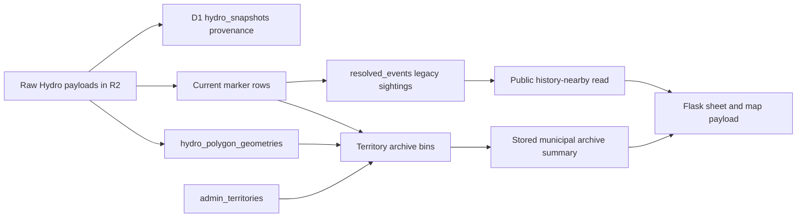

# Archive Storage Readers And Writers

Inventory date: 2026-11-01. Recorded in audit commit `7369073`, including the prior
`f6e15a8` maintenance work. This is a code dependency inventory for
[storage phase S0](plans/storage-retention.md#phase-s0--bounded-inventory-and-recovery-rehearsal),
not a table-size measurement, query-plan profile, recovery rehearsal or migration approval.
No production rows, objects, schema, retention policy or schedules were changed for this inventory.

## Production Flow

The diagram distinguishes two histories: address-nearby reads use legacy `resolved_events`, while
the province Archive report uses territory-bin materialization. Their keys and count units are not
interchangeable. The table name `resolved_events` does not establish confirmed restoration.

## D1/R2 Ownership And Consumers

Worker function names below refer to [src/worker.js](../src/worker.js), unless linked otherwise.

| Store / key | Writers and triggers | Readers and dependent behavior | Preservation boundary |
| --- | --- | --- | --- |
| R2 Hydro payloads; D1 `hydro_snapshots` | `syncHydroFromContainerResult` / `syncHydroSourceFromContainer` call `storeSnapshot` after scheduled container fetches. `storeSnapshot` writes raw bytes, checksum/content metadata and the D1 pointer. | Source replay; `readIngestionHealth`; operational status. Raw inputs feed marker and polygon parsers. | Keep source type/version, R2 key, checksum, HTTP status and capture time aligned. An R2 object alone is not proof of a complete/replayable D1 generation. |
| `feed_versions` | `upsertFeedVersion` during source synchronization. | `currentFeedVersionMap`; public Hydro/nearby handlers; protected map-layer reads; operational status. | Publication/version selectors must agree with retained marker rows. Never advance a selector before its data is usable. |
| `current_outage_records`, `current_planned_interruptions` | `ingestBisMarkers`, `ingestAipMarkers`; maintenance `cleanupDerivedHydroFeedHistory` calls `pruneTableToLatestVersion`. | [durableHydroResponse / durableNearbyResponse](../src/durable-read-handlers.js); `runtimeOperationalMapLayersResponse`; `runtimePreviousMapLayersResponse`; importantly, `outageStatsForPolygon` derives bin counts/customer/time values from matching outage markers. | Old marker rows are already pruned. Preserve raw payload replay and original derived bin values before assuming a later backfill is identical. |
| `resolved_events` | `upsertResolvedEvents` from marker ingestion, using `eventKey`, source-version membership and repeated-sighting increments. | Public `durableHistoryNearbyResponse` → `nearbyHistoryRows`; protected `runtimePreviousMapLayersResponse`; status. Flask durable address-history matching consumes the public response. | Preserve legacy keys, source memberships, counts, observation bounds and spatial/time filtering. Do not reinterpret estimated/last-seen times as confirmed restoration. |
| `hydro_polygon_geometries` | `ingestHydroPolygons` parses retained KMZ sources. | `hydroPolygonsForMunicipalArchive`; `hydroGeometryRows` for protected operational/history layer handlers; `municipalArchiveCompleteness`; maintenance CLI polygon batches. | Preserve source/version/polygon references, original `raw_coordinates`, canonical geometry, bounds and centroids until an equivalent versioned representation is verified. |
| `admin_territories` | Operator-only `runtimeAdminTerritoriesImportResponse`; maintenance CLI import. | `adminTerritoryRows` in assignment; completeness audit; summary territory join; maintenance status. | Assignment uses full geometry; the summary uses display geometry/bounds/centroids. Keep territory/source versions and identifiers with the original assignments. |
| `previous_outage_territory_bins` | `runMunicipalArchiveBackfill` → `upsertMunicipalArchiveAssignment`; maintenance CLI `assignmentSql`. Changed Hydro generations and hourly maintenance invoke bounded batches. | `buildMunicipalArchiveSummary` / `municipalArchiveWindow` / `municipalArchiveLargest` / `municipalArchiveLatest`; cursor recovery; completeness and explicit status; maintenance CLI. | Primary and overlap assignments differ. Preserve original event/customer/time values and territory references, not just polygon membership. |
| `municipal_archive_build_state` | `setBuildState`: backfill cursors, summary refresh time and daily cleanup markers; maintenance CLI `buildStateSql`. | Cursor selection, summary refresh gate, health/freshness, maintenance gates and explicit operator status. | Checkpoint the state with the corresponding bin/summary generation. A cursor without the materialization does not prove completion. |
| `municipal_archive_summaries` / `previous_archive_summary` | `refreshMunicipalArchiveSummary` → `storeMunicipalArchiveSummary`; normally daily-gated after backfill, or explicitly invoked by an operator. | Public `runtimeMunicipalPreviousArchiveSummaryResponse`; ingestion-health coherence/freshness reads; Flask `previous_operational_archive_summary` through its public runtime client. | Keep summary JSON, source cursor and generation time consistent. Public requests read stored data and must not rebuild the large bin tables. |
| `runtime_summaries` | `storeRuntimeSummary`: Hydro, maintenance, disclosure sync and map-context materializations. | `readRuntimeSummary`: public map-context fast path and operational summaries. | Preserve keyed generations and published context availability; failures must not become authoritative empty context. |
| D1 `disclosure_sources`, `disclosure_outage_events`, `disclosure_annual_metrics`, `disclosure_geometries`; raw disclosure files in R2 | `runDisclosureSchedule`, `archiveDisclosureSource`, `parseDisclosureSource`, `syncDisclosures` and its `syncDisclosure*` helpers mirror container parser/export results; source-attempt/status helpers update provenance. | `runtimeRegionalMetricLayers`, `runtimeDisclosureLayers` and `runtimeMapContextResponse`; due-source scheduling; published-context summary; operational status. | Keep source keys, source files/checksums, row references, parser status and full/display geometry relationships. Context is regional disclosure evidence, not address-level service certification. |
| `ingestion_runs` | Run-start/finish helpers; `cleanupIngestionRuns` expires running jobs after three hours and removes terminal runs older than 30 days. | Ingestion health, scheduling and operational status. | Operational history is bounded separately from raw/source history; it is not authorization to delete archives. |

## Public, Private And Local Boundaries

- [src/durable-read-handlers.js](../src/durable-read-handlers.js) owns the public current and
  nearby/history JSON reads. Historical centroid/time filters and response limits are part of
  existing behavior; they are not an exact polygon-intersection or complete-incident contract.
- Public `previous-archive-summary` reads only the stored summary and publication cursor. The
  [pure summary helpers](../src/archive-summary.js) shape/validate it; ingestion health compares
  nested windows, part-versus-whole figures and cursor freshness against the served generation.
- `operational-map-layers`, `previous-map-layers`, previous groups, archive status/completeness,
  territory import and backfill routes are protected. Their tables still matter for migrations,
  but they must not become container dependencies without a separately designed credential path.
- [app/durable_runtime.py](../app/durable_runtime.py) permits only the two public materialized
  `map-context` and `previous-archive-summary` reads. [app/services.py](../app/services.py) also
  uses the separate public Hydro/nearby/history URLs for durable search paths.
- [app/views.py](../app/views.py), [app/sheet_views.py](../app/sheet_views.py) and browser map/detail
  modules consume service payloads; they do not query D1 directly. Migration comparisons must
  include rendered domain/radius/scope behavior and both independent service fakes.

## SQLite And Maintenance Paths

SQLite is a separate local/container-compatible schema defined in [app/db.py](../app/db.py).
Do not assume that a matching table name implies matching columns, keys, semantics or durability.

| Local store | Writer | Reader / export / artifact dependency |
| --- | --- | --- |
| Raw files and `raw_snapshots` | [Hydro collector](../app/hydro.py): `_fetch_payload_files`, `_register_snapshot` | Version/no-work detection, `raw_snapshot_payload_path` for the internal export callback, current/history/summary builders and collection status in `AppService`. Registration is required even if the file exists. |
| `outage_records`, `planned_interruptions`, `outage_geometries` | Hydro `_ingest_markers`, `_ingest_polygons` | `_find_current_matches`, `_find_archived_outage_matches`, `_build_current_operational_map_layers`, `_build_previous_operational_map_layers`, local `_build_previous_operational_archive_summary`, `_previous_outage_groups` and local coverage diagnostics. |
| Local `resolved_events` | Hydro `_upsert_resolved_event` | Local coverage statistics. Local previous-map/summary/history builders also read the retained marker/geometry tables directly; they are not simply mirrors of the D1 history read. |
| Local disclosure source/event/metric/geometry tables | [DisclosureCollector](../app/disclosures.py): `_register_source`, `_ingest_xlsx_rows`, `_ingest_pdf_rows`, `_ingest_annual_metrics`, geometry creation/copy helpers | `AppService.disclosure_export` feeds Worker mirroring; local context builders and `context_geometry_payload`; [build_region_geometry_asset.py](../scripts/build_region_geometry_asset.py) produces the committed display-geometry assets. |
| Baked SQLite snapshot and static context geometry | Image build / explicit operator rebuild | Flask fallback and disclosure/regional context. Container runtime writes are ephemeral, so they are not durable production archive storage. |

[municipal-archive-backfill.mjs](../scripts/maintenance/municipal-archive-backfill.mjs) is a separate
operator tool with territory import, polygon batching, assignment SQL, build-state updates and
status commands. Its status queries include explicit counts/distincts; do not turn those into
routine public health polling. Runtime code does not import this script. A migration must check
both this tool and the Worker implementation for compatible geometry/cursor/assignment behavior.

## Index And Replay Dependencies

- [0003](../migrations/0003_history_nearby_index.sql): `idx_resolved_events_nearby` supports the
  legacy address-history read. The later sort-time index does not replace the spatial contract.
- [0007](../migrations/0007_hydro_polygon_geometries.sql): polygon source/version uniqueness and
  source/bounds access. [0009](../migrations/0009_municipal_archive_bins.sql) adds territory bounds,
  bin assignment uniqueness, territory/polygon lookups and build state.
- [0010](../migrations/0010_municipal_archive_summary.sql) stores the summary;
  [0011](../migrations/0011_archive_health_indexes.sql) supports assignment/completeness checks.
- [0013](../migrations/0013_d1_row_read_indexes.sql) rebuilds compact current marker tables and adds
  independently seekable archive cursor, primary-time, latest-dedup, largest, history-sort and
  disclosure scheduling/context indexes, plus `runtime_summaries`. Preserve expression/order
  semantics when comparing query plans; retaining an index name is not proof of equivalent cost.

**Important replay gap:** `outageStatsForPolygon` joins polygons to marker rows from the same
source version. If those marker rows have been pruned, it falls back to `eventCount: 1`, null
customers and an observation timestamp. Rebuilding from the remaining D1 geometry alone can
therefore change original bin values. Raw R2 retention is necessary but does not prove an exact
rebuild without a tested parser/version/territory replay and preserved original derived values.

## Next Bounded Storage Work

This completes the code reader/writer map only. S0 remains open for:

1. Supported, cheap table/index sizing and representative indexed samples; no recurring full scans.
2. `EXPLAIN QUERY PLAN` and measured rows/latency/bytes for dense/sparse history, current/map,
   summary builders, cursor/backfill, geometry detail and disclosure context.
3. R2 object/checksum/parse coverage, an access-controlled checkpoint/export manifest and an
   isolated recovery/replay rehearsal. Do not put database exports or private search data in Git.
4. Quantified savings/peak-space/retention budgets and old/new query/render parity before any cutover.

Usage aggregates, address/search caches and future notification subscriptions have distinct purposes
and privacy/retention rules. They are outside this archive dependency map; do not repurpose them as
archive storage or delete their contents incidentally.
